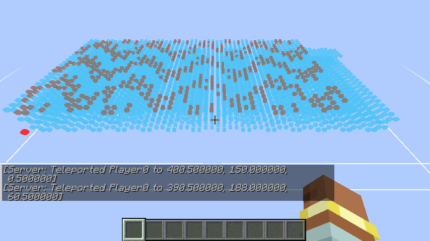
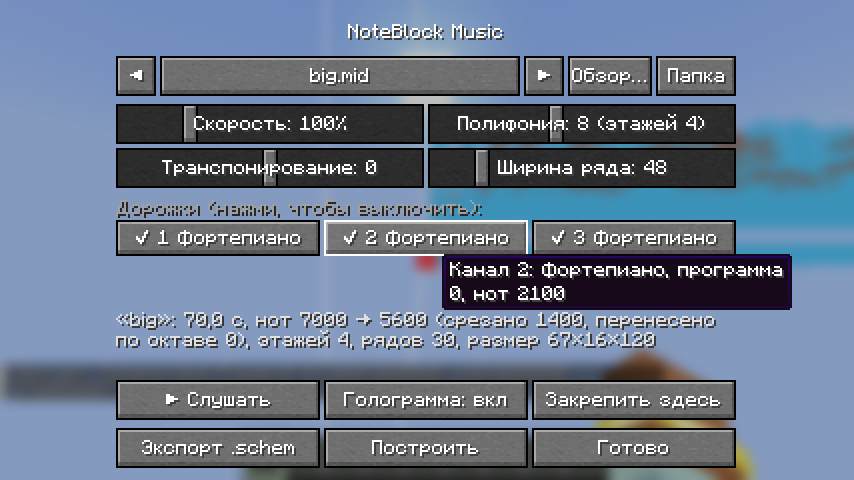

# NoteBlock Music

Fabric-мод для **Minecraft 26.2**: загружаешь музыку — получаешь схематику с нотными блоками, которая её играет.

> Статус: **этап 5** — MIDI, **Note Block Studio (.nbs)** и аудио (MP3 / WAV / OGG); экспорт в **.schem, .litematic, .nbt, .nbs**;
> интерфейс на **русском и английском**. Окно настроек, предпрослушивание, голограмма, постройка по кнопке.



## Как пользоваться

### Окно (клавиша **R**, или «Настроить» в Mod Menu)



1. Положи `.mid`, `.nbs`, `.mp3`, `.wav` или `.ogg` в `.minecraft/nbmusic/input/` (кнопка «Папка») или выбери файл
   через «Обзор…»; ◀ ▶ листают папку. Последний файл и настройки запоминаются (`config/nbmusic.json`).
2. Настрой скорость, полифонию, транспонирование и ширину ряда; лишние дорожки выключаются кнопками каналов
   (наведи — увидишь программу и число нот).
3. **▶ Слушать** — предпрослушивание звуками нотных блоков.
4. Голограмма показывает, где и какой будет постройка (цвет — инструмент, красный — кнопка старта).
   Она следует за взглядом; «Закрепить здесь» оставляет её на месте.
5. **Построить** — файл уходит на сервер, схема встаёт ровно по голограмме. Нужны права оператора
   (в одиночной игре — «Разрешить читы»). **Экспорт** работает и без них (см. ниже).

### Экспорт

Кнопка «Экспорт» и `/nbmusic export` пишут в `nbmusic/output/` сразу четыре файла:

| Файл | Для чего | Куда ещё кладётся копия |
|---|---|---|
| `.schem` | WorldEdit / FAWE: `//schem load`, `//paste` | `config/worldedit/schematics`, если есть WorldEdit |
| `.litematic` | Litematica: голограмма-чертёж и принтер | `.minecraft/schematics` — сразу в меню «Загрузить схему» |
| `.nbt` | без модов: `/place template nbmusic:<имя>`, структурный блок (до 48³) | в папку мира (одиночная игра / сервер) |
| `.nbs` | Note Block Studio: поправить ноты руками и загрузить обратно | — |

### Note Block Studio

`.nbs` загружается без потерь: инструменты и высоты берутся из файла как есть (без угадывания по MIDI),
вместо MIDI-каналов в окне — список инструментов. Поддерживаются старый формат и версии 1–5.

Язык интерфейса — как у игры (русский или английский). Игроки без мода на сервере видят сообщения на английском.
Клавишу можно сменить в «Управлении». Окно, предпрослушивание, голограмма и экспорт работают на любом сервере;
для «Построить» мод должен стоять и на сервере.

### MP3, WAV, OGG

Аудио превращается в ноты нейросетью [Basic Pitch](https://github.com/spotify/basic-pitch) (Spotify) —
прямо в игре, без интернета и сторонних программ: модель (230 КБ) исполняется собственным интерпретатором
на Java. Трек на 3 минуты распознаётся в фоне примерно за 17 с на 12-поточном процессоре
(на 4-ядерном — до минуты); в окне видна полоса прогресса.

- Лучше всего получаются **сольные инструменты и фортепиано**. Плотный микс с вокалом и барабанами даст
  «кашу» из нот — для таких песен лучше найти MIDI.
- Ударные распознаются как высотные ноты, а не как барабаны.
- Результат кэшируется (`nbmusic/cache/`), копия кладётся в `nbmusic/output/<имя>.mid` — её можно поправить
  в любом MIDI-редакторе и загрузить обратно. На сервер уходит уже распознанный MIDI.
- Команды тоже понимают аудио: распознавание идёт в фоне, ответ приходит в чат. OGG — только через окно
  (декодер есть лишь в клиенте игры).

### Команды

Нужны права оператора / читы:

| Команда | Что делает |
|---|---|
| `/nbmusic list` | список файлов во `input/` |
| `/nbmusic info <файл> [скорость%] [полифония] [ширина]` | статистика: длительность, сколько нот влезло, этажи, ряды, размер |
| `/nbmusic export <файл> [скорость%] [полифония] [ширина]` | пишет `nbmusic/output/<имя>.schem` (и в `config/worldedit/schematics`, если есть WorldEdit) |
| `/nbmusic build <файл> [скорость%] [полифония] [ширина]` | строит схему в 2 блоках перед игроком, **в сторону взгляда** |

- **скорость%** — 100 = исходный темп, 50 = вдвое медленнее (помогает быстрым мелодиям: шаг редстоуна всего 0,1 с).
- **полифония** — сколько нот максимум звучит одновременно (1–18, по умолчанию 8). Лишние отбрасываются, начиная с самых тихих. Каждые 2 ноты — ещё один этаж высотой 4 блока.
- **ширина** — длина ряда змейки в блоках (8–1024, по умолчанию 48).

Запуск — кнопка напротив игрока, координаты пишутся в чат. Музыка начинается через 0,1–1 с после нажатия (время на подъём сигнала по этажам).

После `export` схему можно вставить WorldEdit'ом: `//schem load <имя>`, `//paste` — кнопка окажется в 2 блоках к востоку от тебя; повернуть — `//rotate 90` перед вставкой.

> ⚠️ Редстоун работает только в загруженных чанках. Если схема уходит дальше дистанции симуляции, музыка остановится — стой рядом или уменьши `ширину`.

## Как устроена схема

```
вид сверху, один этаж:

  B          B — кнопка, стояк с лестницей на этажи
  ┗━┓        R — повторитель (пауза 1–4 тика)
    ─R─C─R─R─C─R─C─┐   C — носитель, по бокам от него нотные блоки
                   │   ─ │ — пыль разворота (без задержки)
    ┌─C─R─C─R─R─C─R┘
    │
    └R─C─R─ ...
```

- Песня — цепочка повторителей и носителей, уложенная **змейкой**: ряды по X, развороты из пыли.
  У пыли нет задержки, поэтому развороты не сбивают ритм.
- Аккорд из K нот раскладывается на ⌈K/2⌉ **этажей**. Каждый этаж — копия змейки со своими нотами,
  повороты у всех одинаковые.
- От кнопки сигнал поднимается по лестнице-стояку; на отводах стоят повторители, подобранные так,
  чтобы все этажи стартовали в один и тот же тик.
- Инструмент выбирается по программе General MIDI (фортепиано → harp, бас → bass, гитары → guitar…),
  ударные канала 10 → basedrum/snare/hat. Если нота не попадает в 2-октавный диапазон инструмента,
  берётся запасной инструмент семейства, иначе — перенос на октаву.

## Сборка

Нужна Java 25.

```bash
./gradlew build              # jar в build/libs + юнит-тесты + серверные GameTest
./gradlew runGameTest        # headless-сервер: строит змейку (восток, север, 9 этажей), жмёт кнопку,
                             # сверяет тик каждой ноты с аранжировкой
./gradlew runClientGameTest  # настоящий клиент: команды, окно как игрок (R, «Слушать», «Закрепить», «Построить»),
                             # экспорт (/place template, Litematica), MP3/OGG, скриншоты
```

Чтобы клиентский тест проверил `.litematic` настоящей Litematica, положи jar-файлы Litematica и malilib
в папку `run-mods/` (она не коммитится) — они подключатся только к игровым тестам.

```bash
./gradlew runClient          # запустить игру с модом
```

## Структура

```
dev.nbmusic.core        чистая Java, без Minecraft (тестируется JUnit)
  ├─ io/                MidiDecoder, MidiWriter, NbsFormat, AudioDecoder (WAV/MP3/OGG), Resampler
  ├─ transcribe/        интерпретатор ONNX, BasicPitch (окна, склейка), NoteExtractor, кэш
  ├─ arrange/           Arranger (квантизация, диапазоны, полифония), InstrumentMapper
  ├─ layout/            LayoutGenerator (змейка, этажи, стояк) → BlockGrid, BlockStates (поворот)
  └─ export/            SpongeSchematicWriter (.schem v3), LitematicWriter, StructureWriter (.nbt)
dev.nbmusic.command     /nbmusic
dev.nbmusic.client      окно, предпрослушивание, голограмма (гизмо), Mod Menu
dev.nbmusic.net         загрузка файла на сервер кусками по 30 КБ и запрос постройки
dev.nbmusic.world       SchematicPlacer, SongBuilder, SchematicExport — постройка и экспорт
src/gametest            серверный GameTest с настоящим редстоуном + клиентский тест со скриншотами
```

## План

- [x] **Этап 1.** MIDI → `.schem`, команда, постройка в мире, тесты тайминга
- [x] **Этап 2.** Укладка змейкой с этажами для аккордов, поворот по взгляду игрока
- [x] **Этап 3.** Окно: выбор файла, дорожки, темп, транспонирование; предпрослушивание; голограмма; постройка по кнопке
- [x] **Этап 4.** WAV/OGG/MP3 → распознавание нот Basic Pitch прямо в моде (без нативных библиотек, +270 КБ)
- [x] **Этап 5.** `.litematic`, `.nbt` (`/place template`), импорт/экспорт `.nbs`, сохранение настроек, русский и английский

## Публикация

См. [PUBLISHING.md](PUBLISHING.md): `MODRINTH_DEBUG=1 ./gradlew modrinth` — проверка без загрузки,
`MODRINTH_TOKEN=… ./gradlew modrinth` — загрузка версии на Modrinth. История изменений — [CHANGELOG.md](CHANGELOG.md).

## Лицензия

MIT. Сторонние компоненты (модель Basic Pitch — Apache-2.0, javamp3 — MIT) — см. [THIRD_PARTY.md](THIRD_PARTY.md).
